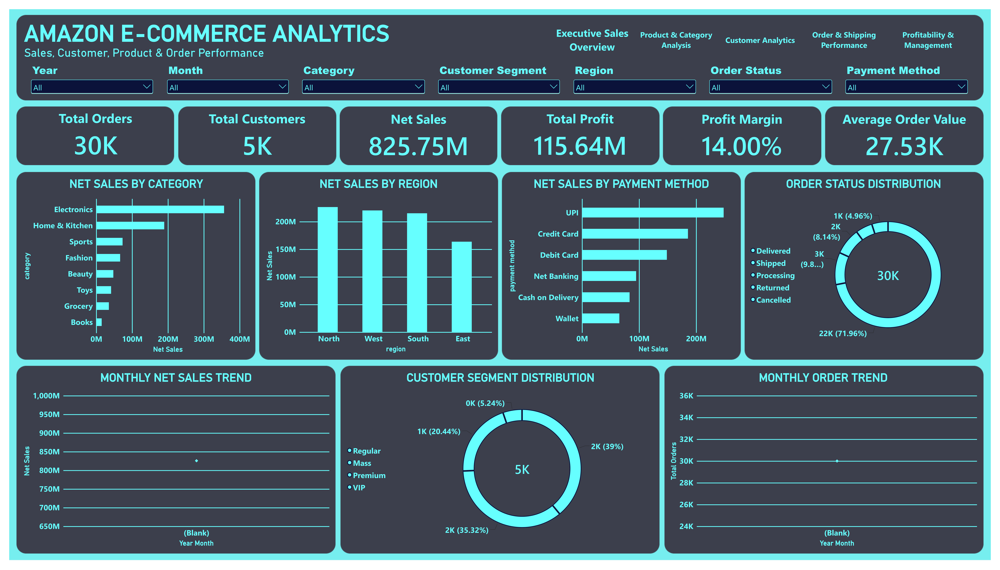
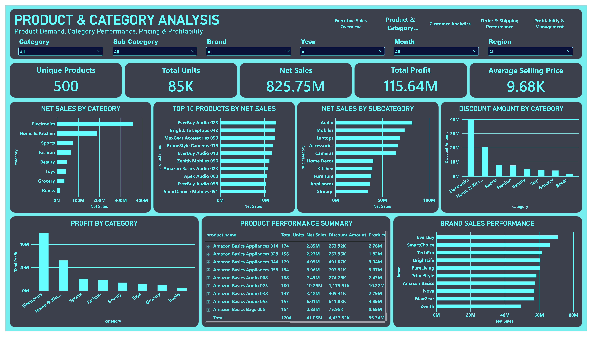
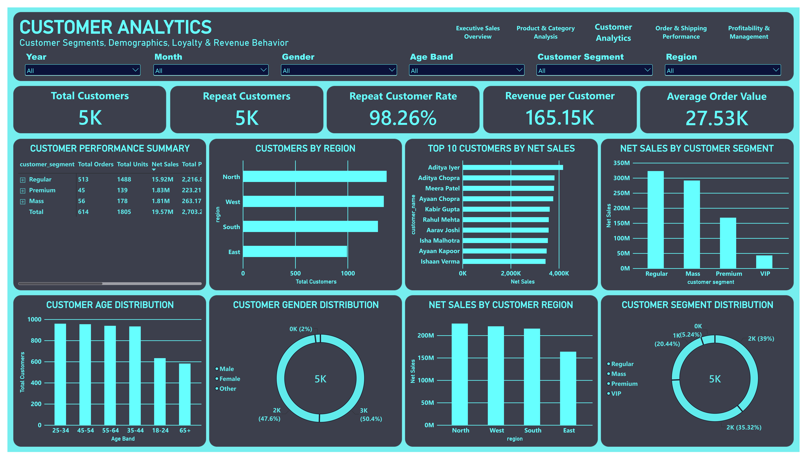
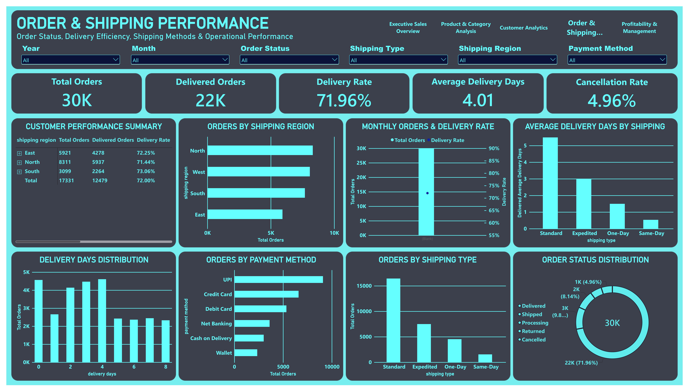
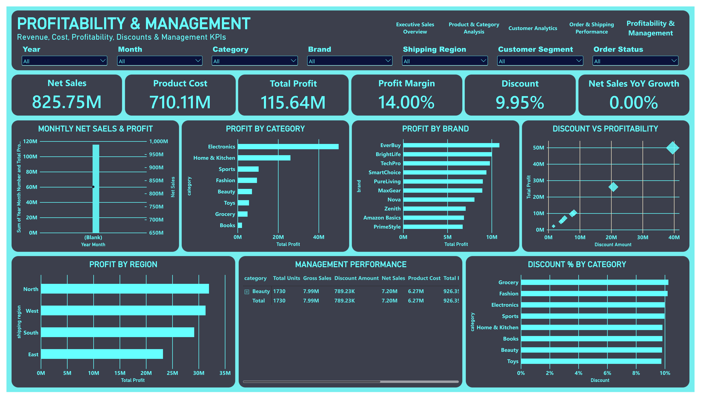

# Amazon E-Commerce Analytics | MySQL & Power BI

An end-to-end **E-Commerce Data Analytics and Business Intelligence project** using MySQL and Microsoft Power BI to explore customer behavior, order activity, product performance, sales, discounts, delivery operations, and profitability.

The project uses a relational MySQL database to combine customer, order, order-item, and product information into a reusable analytical view. The prepared data provides a foundation for SQL-based business analysis and interactive Power BI reporting.


> **Project Type:** Personal Data Analytics Portfolio Project  
> **Database:** MySQL 8.0  
> **Database Name:** `amazon_ecommerce_analytics`  
> **Visualization:** Microsoft Power BI  
> **Dataset:** Synthetic / Practice Dataset

---

## Project Overview

E-commerce businesses generate data across customers, orders, products, payments, and deliveries. Analyzing these areas together helps provide a more complete understanding of business performance.

This project organizes e-commerce data in a relational MySQL database and combines its core entities through SQL joins and a reusable analytical view.

The resulting analytical dataset supports exploration of sales performance, customer segments, product categories, discounts, delivery operations, and product-level profitability.

## Project Objectives

- Build and explore a relational e-commerce database using MySQL.
- Understand customer, order, order-item, and product data.
- Combine multiple tables using SQL joins.
- Develop a reusable SQL analytical view.
- Calculate gross sales, discount amount, net sales, product cost, and profit.
- Prepare structured data for Power BI reporting.
- Explore customer, product, sales, and operational performance.
- Identify data-quality issues and document metric definitions.

## Database Architecture

The project uses the MySQL database:

```sql
amazon_ecommerce_analytics
```

### Core Database Tables

| Table | Description |
|---|---|
| `customers` | Customer demographics, location, segment, and registration information |
| `orders` | Order status, order date, payment method, shipping details, and delivery days |
| `order_items` | Product quantities, unit prices, and discounts for individual order items |
| `products` | Product names, categories, subcategories, brands, unit costs, and selling prices |

### Database Relationship Overview

```text
CUSTOMERS
    |
    | customer_id
    |
  ORDERS
    |
    | order_id
    |
ORDER_ITEMS
    |
    | product_id
    |
 PRODUCTS
    |
    v
VW_AMAZON_SALES
    |
    v
  POWER BI
```

The `vw_amazon_sales` view combines the four core tables into a reporting-oriented dataset.

## SQL Analytical View

The project includes a reusable SQL view:

```sql
vw_amazon_sales
```

The view combines:

- Order information
- Customer attributes
- Product details
- Order-item quantities
- Unit prices
- Discount percentages
- Calculated financial fields

### Derived Financial Metrics

| Metric | Calculation |
|---|---|
| Gross Sales | Quantity × Unit Price |
| Discount Amount | Gross Sales × Discount Percentage / 100 |
| Net Sales | Gross Sales − Discount Amount |
| Product Cost | Quantity × Product Unit Cost |
| Profit | Net Sales − Product Cost |

These calculations provide a foundation for analyzing sales after discounts and product-level profitability.

**Profit definition:** The calculated profit subtracts product cost from net sales. It does not deduct shipping expenses, payment processing fees, or other operating expenses. It should not automatically be interpreted as net business profit.

## Analytical Areas

### 1. Sales & Transaction Analysis

Explore order activity, sales value, discounts, and transaction trends.



Potential analysis:
- Gross sales and net sales
- Order volume
- Average order value
- Discount impact
- Sales trends over time
- Order status distribution

### 2. Customer Analytics

Use customer demographic, geographic, and segment information to explore purchasing behavior.



Potential analysis:
- Customer distribution by region
- Customer segment performance
- Customer demographics
- Customer purchasing activity
- Revenue contribution by customer group

### 3. Product & Category Analytics

Use product attributes and order-item information to compare product performance.



Potential analysis:
- Product revenue
- Units sold
- Category and subcategory performance
- Brand performance
- Product cost and selling price
- Product-level profitability

### 4. Shipping & Operations Analytics

Use order status, shipping type, destination, and delivery-day information to examine operational performance.



Potential analysis:
- Orders by status
- Orders by payment method
- Delivery days by shipping type
- Shipping performance by region
- Geographic order distribution

### 5. Profitability Analysis

Use the calculated financial fields to investigate product-level financial performance.



Potential analysis:
- Gross sales
- Discount amount
- Net sales
- Product cost
- Product-level profit
- Profit contribution by category and brand

## Business Questions

The project provides a foundation for investigating:

**Sales Performance**
- How are gross sales and net sales changing over time?
- How much sales value is deducted through discounts?
- What is the number of unique orders?
- What is the average order value?

**Customer Analytics**
- Which customer segments contribute the most sales?
- How does purchasing activity vary by region?
- Which customer groups contribute to product demand?

**Product Performance**
- Which products generate the highest net sales?
- Which categories contribute the most product-level profit?
- How do product costs compare with selling prices?
- How do discounts affect product profitability?

**Operations**
- How are orders distributed across order statuses?
- Which payment methods are used most frequently?
- How does delivery time vary across shipping types?
- Which regions have different delivery patterns?

## Power BI Dashboard

Microsoft Power BI is used as the reporting and visualization layer for the project.

The Power BI report is part of the project workflow. Exact dashboard page titles, KPI values, and visual descriptions will be documented here after the report pages have been verified.

The SQL analytical view provides a reusable data source for building customer, product, sales, and operational reports.

## Data Quality & Validation

Data validation is an important part of preparing the dataset for reliable reporting.

The following checks should be considered:

- Check duplicate customer, order, product, and order-item identifiers.
- Validate customer references in the orders table.
- Validate order and product references in the order-items table.
- Investigate missing values and invalid dates.
- Check zero or negative quantities and prices.
- Validate discount percentages.
- Reconcile gross sales, discounts, net sales, product cost, and profit.
- Define whether cancelled and returned orders are included in sales calculations.
- Use distinct order IDs when counting orders.

### Date Validation

The supplied SQL records include `0000-00-00` date values in examples of order and customer registration data.

These values should be investigated and handled before using the date fields for time-based reporting, customer cohorts, or registration trends.

### Aggregation Consideration

The `vw_amazon_sales` view has an **order-item-level grain**.

One order can contain multiple products, meaning one `order_id` may appear in multiple rows.

Use:

```sql
COUNT(DISTINCT order_id)
```

to calculate unique orders rather than using a simple row count.

## Tools & Technologies

| Technology | Purpose |
|---|---|
| MySQL 8.0 | Relational database management |
| MySQL Shell | Database interaction and SQL execution |
| SQL | Joins, calculations, querying, and analytical views |
| Microsoft Power BI | Interactive dashboards and business reporting |
| DAX | KPI calculations, where implemented |
| Power Query | Data preparation, where implemented |
| GitHub | Version control and portfolio documentation |

## Skills Demonstrated

- MySQL database management
- SQL querying and analysis
- Relational database concepts
- Primary and foreign key relationships
- SQL joins
- SQL views
- Data transformation
- E-commerce sales analytics
- Customer segmentation
- Product and category analysis
- Discount and profitability analysis
- Delivery operations analysis
- Data validation
- Power BI reporting
- Business intelligence and data storytelling

## Repository Structure

```text
Amazon-Ecommerce-Analytics-MySQL-Power-BI/
│
├── README.md
│
├── database/
│   ├── customers.sql
│   ├── orders.sql
│   ├── order_items.sql
│   ├── products.sql
│   └── routines.sql
│
├── power-bi/
│   └── Amazon_Ecommerce_Analytics.pbix
│
├── screenshots/
│   ├── executive-overview.png
│   ├── customer-analysis.png
│   ├── product-analysis.png
│   ├── shipping-operations.png
│   └── profitability-analysis.png
│
└── documentation/
    ├── project-overview.md
    ├── business-requirements.md
    ├── database-schema.md
    ├── data-dictionary.md
    ├── sql-analysis.md
    ├── kpi-dictionary.md
    ├── dashboard-documentation.md
    └── data-validation.md
```

*The folder structure is a proposed organization. Keep only files that are actually included in the repository, and update the dashboard filenames to match the exported report images.*

## How to Explore the Project

1. Install MySQL 8.0.
2. Open MySQL Shell and connect to your MySQL instance.
3. Import the supplied SQL files into the `amazon_ecommerce_analytics` database.
4. Verify the source tables and their relationships.
5. Inspect the `vw_amazon_sales` analytical view.
6. Connect Power BI Desktop to the MySQL database or analytical view.
7. Explore the dashboard pages and available filters.
8. Review the documentation for metric definitions and data-quality considerations.

## Limitations & Future Improvements

Potential improvements include:

- Customer lifetime value analysis
- Customer cohort and retention analysis
- Product affinity analysis
- Sales forecasting
- Delivery performance monitoring
- Return and cancellation analysis, if corresponding data is available
- Discount effectiveness analysis
- Advanced customer segmentation
- Automated Power BI refresh
- Power BI Service deployment

## Project Purpose

This project demonstrates how relational databases and business intelligence tools can transform e-commerce transaction data into structured business reporting.

It combines MySQL database development, SQL joins, analytical views, financial calculations, customer and product analysis, and Power BI visualization.

The project demonstrates practical skills relevant to Data Analyst, Business Analyst, and Business Intelligence roles.

## Author

**Altamash Nizamuddin**

Data Analyst | Excel • Power BI • Python • MySQL

- GitHub: [@altamash-analyst](https://github.com/altamash-analyst)
  
- Email: [altamash9876@gmail.com](mailto:altamash9876@gmail.com)
  
- **LinkedIn:** https://www.linkedin.com/in/altamash-nizamuddin-a208152a3?utm_source=share_via&utm_content=profile&utm_medium=member_android

---

Amazon E-Commerce Analytics, MySQL E-Commerce Database, SQL Sales Analysis, Power BI E-Commerce Dashboard, E-Commerce Data Analytics, Customer Analytics, Product Performance Analysis, Sales and Profitability Analysis, MySQL SQL Project, Business Intelligence Portfolio, Data Analyst Portfolio.
